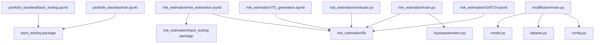

# Architecture

<!-- generated 2026-10-16 from the merged history of Study_RL and Study_DL_and_Coding -->

## Structure

StudyLab is not one program. It is four independent study areas that share only a Python environment:

```
StudyLab/
├── rl/                        reinforcement learning course work
│   ├── notebooks/             08 value iteration … 30 PPO (12 notebooks, self-contained)
│   ├── src/                   a3c.py, trpo.py
│   └── assets/                mc.png
├── dl/
│   └── msdiffusion/           third-party diffusion model (satellite pattern-of-life)
│       └── main.py            entry point: config → dataset → model → logger
├── quant/
│   ├── portfolio_backtest/    back_testing/ package + 2 notebooks + general_results/
│   ├── risk_estimation/       lib/ (SigCWGAN) + back_testing/ + train.py/evaluate.py + 4 notebooks
│   ├── wrds_pipeline/         main.py, common.py, 3 notebooks
│   └── els_data_eda.ipynb     standalone EDA, no local imports
└── coding/
    └── baekjoon.ipynb
```

Entry points: `quant/risk_estimation/train.py` (SigCWGAN training), `quant/risk_estimation/evaluate.py`,
`dl/msdiffusion/main.py`, `quant/wrds_pipeline/main.py`. Everything else is a notebook.

## Dependencies

Internal imports are flat and resolved from the working directory, not from the repository root — there is no
installable package and no `__init__.py` above the project level.



Highest fan-in: `risk_estimation/lib/` (4 callers) and the two `back_testing` packages (3 callers together) —
these are the interfaces worth keeping stable.

External packages: `torch`, `numpy`, `pandas`, `matplotlib`, `scipy`, `seaborn`, `scikit-learn`, `statsmodels`,
`tqdm`, `joblib`, `requests`, `optuna`, `pytorch-ignite`, `torch-geometric`, `signatory`, `gymnasium`, `yfinance`,
`econml`. The full list with notes is in `requirements.txt`.

## Conventions

- **Notebook-first.** Research runs in notebooks; only stable pieces moved into `.py` modules. Cell outputs are
  committed, which is why the notebooks are large (0.2–1.3 MB each).
- **Results next to code.** `general_results/*.csv`, `numerical_results/**/*.torch` and saved weights are
  version-controlled so a past run can be read without re-running it.
- **Relative working directory.** Scripts and notebooks assume the current directory is their own project folder.
- **Naming.** Directories and files are lower snake case after the 2026-10-16 restructure; the RL notebooks keep
  their course numbers as a prefix.
- No linter or formatter config, no CI, and no tests anywhere in the repository.

## Impact

**High-coupling zones** (a change here reaches several callers):

| Module | Callers | Note |
|---|---|---|
| `quant/risk_estimation/lib/` | `train.py`, `evaluate.py`, `TS_generation.ipynb`, `GATCN.ipynb`, `risk_estimation.ipynb` | SigCWGAN algorithms, data loading, plotting |
| `quant/*/back_testing/` | 3 notebooks | strategy weights → returns → metrics |
| `dl/msdiffusion/model.py` | `main.py` | the two `forward` methods are the most complex functions in the file |

**Known duplication, deliberately left in place.** `quant/portfolio_backtest/back_testing/` and
`quant/risk_estimation/back_testing/` are two copies of the same library that have since diverged, and their
interfaces are no longer compatible:

| | portfolio_backtest | risk_estimation |
|---|---|---|
| `return_Table(weight_df, …)` | second argument `price_df`, 69 lines | second argument `momentum_df`, 46 lines |
| `cal_turnover` | returns a `pd.Series` | returns a `float` |
| `plot_result` | `(result_df)` | `(result_df, apply_log)` |
| extra | `cal_dynamic_fee` | — |

`metrics.py` and `return_calculate.py` differ; `dynamic_strategy.py` and `__init__.py` are identical. Merging them
would change the behaviour of whichever caller lost its version, and there are no tests to catch that, so the copies
were kept and documented instead. Merge them only together with a run of both notebooks.

**Complexity** (lizard over 275 functions): 7 functions reach cyclomatic complexity 10 or more.

| CRAP_max | cc | Function | File |
|---|---|---|---|
| 132 | 11 | `gtaa5_momentum_strategy` | both `back_testing/dynamic_strategy.py` copies |
| 110 | 10 | `return_Table` | `portfolio_backtest/back_testing/return_calculate.py` |
| 110 | 10 | `update` | `rl/src/trpo.py` |
| 110 | 10 | `gtaa_aggressive3_strategy` | both `dynamic_strategy.py` copies |
| 110 | 10 | `smartdropna` | `wrds_pipeline/common.py` |

`CRAP_max = cc² + cc` is the score a function has at zero effective coverage. Since the repository has no tests,
that bound is also the actual CRAP score, and the usual remedy — characterization tests before refactoring — has to
come first. The ranking above is therefore a reading order for anyone who wants to add tests, not a refactor list.

**Safe zones**: the RL notebooks, `coding/baekjoon.ipynb` and `quant/els_data_eda.ipynb` import nothing local and
can be changed without affecting anything else.
